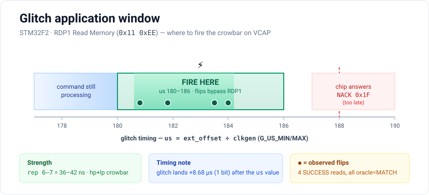

# RDP1 → DUMP: voltage-glitching STM32F2 readout protection to extract flash

How to defeat **RDP Level 1** readout protection on an STM32F2 (the Trezor One's
STM32F205) by voltage-glitching the system bootloader's Read Memory command, and
dump the flash contents — proven end-to-end on a planted rehearsal board:
**PIN `9434` + the full BIP39 mnemonic recovered from glitched memory.**

> Legitimate self-recovery / security-research context. This is the rehearsal
> pipeline for recovering an owner's own locked device.

---

## 1. The target and the barrier

- **Chip:** STM32F2xx, `DEV_ID 0x411` (read from `DBGMCU_IDCODE @ 0xE0042000`).
  F2 has **RDP + WRP only — no PCROP/SPRMOD** (that's F4+). This matters: a
  glitched read can never return a *masked* pattern, so `0xFF` always means
  genuinely-erased flash, never "protection returned FF".
- **RDP Level 1** (option byte ≠ `0xAA` and ≠ `0xCC`; e.g. `0x55`): SWD can't
  read flash, and the system bootloader **refuses Read Memory (`0x11`) with a
  NACK (`0x1F`)**. The flash is otherwise intact.
- **The one weakness:** the bootloader decides whether to honor Read Memory by
  checking the RDP level (`is_rdp_enabled` in `check_RDP_and_get_addr()`). Skip
  that check with a well-placed power glitch and the read proceeds — returning
  real flash bytes.

---

## 2. The attack in one paragraph

Enter the system bootloader (power-cycle with BOOT0 high). Send the Read Memory
command pair `0x11 0xEE` over UART (115200 **8E1**). A crowbar voltage glitch —
a hard, brief short of the **VCAP** core rail (~1.2 V) — fired during the
bootloader's RDP decision flips the `NACK (0x1F)` into an `ACK (0x79)`; the read
then completes and the chip streams back the 256 requested bytes of real flash.
Repeat per 256-byte chunk (or ride a *latched* session that keeps ACKing to
drain many chunks at once), then decrypt offline.

---

## 3. Rig

| Part | Role |
|---|---|
| ChipWhisperer-Lite | glitch generator + trigger (FPGA, cycle-accurate), `clkgen 166.67 MHz` |
| Crowbar (`glitch_hp`+`glitch_lp` FETs) | shorts VCAP to ground on the SMA at the core-rail pad |
| FTDI FT232R (`/dev/ttyUSB0`) | UART bridge to the bootloader (115200 8E1) |
| ST-Link (SWD) | board prep only (set/clear RDP, plant image) — blocked at RDP1 |
| Saleae/fx2 LA | passive UART timing tap (harmless; slow digital lines) |
| Siglent SDS1202X-E scope | pulse verification **between** runs only |

**Trigger:** TIO3 tee'd on the FTDI TX line — the CW arms on the first *rising*
edge of the `0x11` byte (one bit after the start bit). The glitch fires
`ext_offset` clkgen cycles after that edge.

### ⚠️ The scope must be OFF the glitch node during firing
A scope probe on VCAP adds ~15–20 pF right at the injection point — electrically
the same as extra decoupling — and **damps the glitch**. This silently poisoned
an entire overnight run (every flip read FF) until the probe was removed. Use the
scope only for between-run captures; the **LA on the UART lines is fine** (wrong
node, slow signals).

---

## 4. Timing calibration (the make-or-break step)

The RDP decision happens in a narrow window after the command finishes
transmitting and before the NACK goes out. Measured on this rig:



- 2-byte command airtime @115200 8E1 ≈ **191 µs**.
- NACK onset ≈ **196.5 µs** after `0x11` start (scope/LA agree within jitter).
- The campaign's **`us` column = `ext_offset / clkgen`**, and it sits **+8.68 µs
  (exactly one bit)** behind the real glitch time (trigger = first *rising*
  edge). So `us 182 ≈ command-end`, `us 188 ≈ NACK`.
- **Productive window: `us 180–186`** (pulse landing ~189–195 µs after `0x11`),
  straddling the RDP check. All flips cluster here.
- Sweep step `G_US_STEP=0.1` (0.1 µs) is plenty — the window is ~6 µs wide.

Nail this by firing a shot and reading the glitch-to-command/NACK offset on the
scope (CH1=VCAP glitch, CH2=VDD shows the UART envelope) or the LA.

---

## 5. Strength

Crowbar pulse length = `repeat` cycles (`rep`); at 166.67 MHz, 1 rep = 6 ns.

| rep | ns | result |
|---|---|---|
| ≤5 | ≤30 | too weak — no flips |
| **6–7** | **36–42** | **sweet spot** — flips at ~2 % dead |
| 8+ | 48+ | **dead cliff** — 31 % dead, zero flips |

So: `G_RND_LO=33 G_RND_HI=45` (randomize rep6–7 per shot). Deeper is *not*
better here (opposite of some FET-glitcher writeups — crowbar coupling differs).
A "dead" verdict is a recoverable brownout crash, not damage; the chip re-syncs
on the next power-cycle reset (reset-per-shot).

---

## 6. Flips, ghosts, and the latch

- **Flip rate** ≈ 1/400 shots in-band at rep6–7.
- A `SUCCESS` = Read Memory *completed* (ACK + 256 bytes). That means the RDP
  bypass worked; the bytes are the true flash content.
- **Ghost / erase read:** on an *unplanted* chip the completed read returns all
  FF — correct (empty flash), not a failure. The confirmation layer distinguishes
  real data from flukes:
  - **oracle** gate (vs `storage.bin`) for storage chunks,
  - **cross-read** gate (N consistent latched reads agree) for uid/otp3 and for
    the real device where there's no oracle.
- **Latching flip** (~1/11 flips): the bypass *persists for the session* — an
  **unglitched** `0x11 0xEE` keeps ACKing. `chain_unglitched` then drains every
  remaining chunk back-to-back with no further glitching. One latch dumped 18
  chunks in a single burst. **Never interrupt a live drain.**

---

## 7. You only need ~5 reads, not the whole 16 KB

Trezor storage is **NORCOW** (blockwise dict @ `0x08008000`). All secrets live
in the **head** = storage chunks 0–2:
- `(0,2)` EDEK/PVC — salt + encrypted DEK/SAK + PVC = the complete offline
  PIN-crack material
- `(1,2)` the encrypted mnemonic

Chunks 3–63 are blank (`0xFF`) free space. So the attack needs:
**`storage_0000..0002` + `uid` (0x1FFF7A10) + `otp3` (0x1FFF7860)** — the uid/otp3
are the PIN-KDF hardware salt. The campaign **defaults to targeted**
(`storage_0000..0004 + uid + otp3`, 7 reads); `G_FULL=1` dumps all 16 KB.

---

## 8. The full chain (reproduce on the rehearsal board)

```sh
PY=/home/tdaly/.cwvenv/bin/python
cd /home/tdaly/trezor-btc/storage-sim

# --- prep a known-planted RDP1 target ---
$PY set_rdp0.py        # RDP1->RDP0 downgrade + mass-erase (re-run once: the
                       #   erase drops the debug port mid-write; the re-run reads RDP0)
$PY plant_storage.py   # SWD-program storage.bin @ 0x08008000 (readback == storage.bin)
$PY uart_rdp0_test.py  # @RDP0: Read Memory ACKs, head = 4e524332.. (NRC2) canary
$PY set_rdp1.py        # re-arm RDP1 (0x55); Read Memory now NACKs (0x1f1f)

# --- glitch-dump (targeted: storage head + uid + otp3) ---
G_CLKGEN=166666667 G_OFFSET=-45 G_WIDTH=5 \
  G_US_MIN=180 G_US_MAX=186 G_US_STEP=0.1 G_RND_LO=33 G_RND_HI=45 \
  $PY -u rdp1_glitch_campaign_full_mem_dump.py          # + G_FULL=1 for all 16 KB

# --- offline recovery ---
# assemble the banked chunks into a storage image, then:
$PY decrypt_storage.py storage_from_glitch.bin \
    --brute 0000-9999 --uid <12B-uid-hex> [--otp3 <32B-hex>]
#  -> *** PIN FOUND: 9434 ***  +  mnemonic
```

**Verified 2026-10-30:** first clean flip (`#385`, us 180.8, rep7) returned
`NRC2…` (`oracle=MATCH`); a latching flip drained 18 chunks; offline brute-force
recovered **PIN 9434** and the full mnemonic — exact match to `known-answer.json`.

---

## 9. Real locked device — deltas from the rehearsal

- **UID** can't be read via SWD (blocked at RDP1) — glitch it out too, same
  bootloader Read Memory at `0x1FFF7A10`. `otp3` likewise from `0x1FFF7860`.
- **No oracle** — rely on the **cross-read** gate (latched reads must agree).
- Storage layout version (word 1) and the `(0,4)` storage version come out in the
  dump; if version ≥ 5 the PIN KDF switches to the stretched-PIN path — see
  `decrypt_storage.py` / README.
- Flip + latch rates are stochastic; budget for a few thousand in-band shots. A
  single latch dumps the whole head, so the targeted run is fast.

---

## 10. Gotchas (hard-won)

1. **Scope off VCAP during firing** — the single biggest silent confound.
2. **F2 has no PCROP** — FF means erased, period; don't chase masking theories.
3. **Deeper ≠ better** — rep8+ just kills; stay at rep6–7.
4. **Timing is everything** — if flips aren't happening, re-check the glitch
   lands in the command-end→NACK window, not during the command.
5. **Don't interrupt a latch-drain** — it's dumping; let it finish.
6. **All-FF chunks are real** — storage is ~98 % erased by design; only the head
   holds secrets.

See `FINDINGS.md` for the full chronological campaign log and `README.md` for the
storage format and decrypt details.
